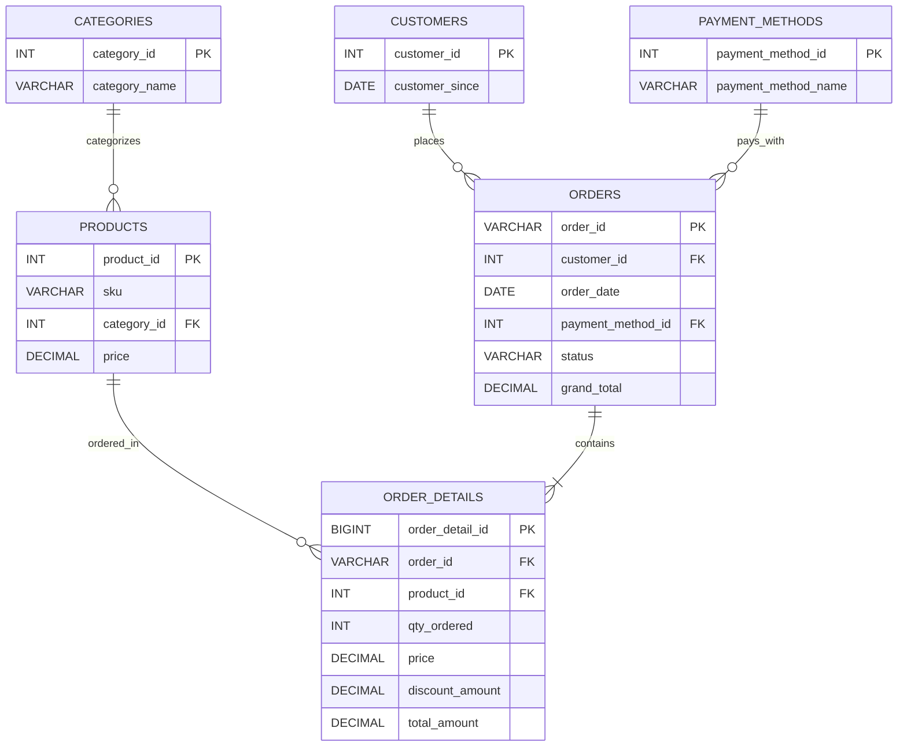

# Entity Relationship Diagram (ERD) — Relational Database

## Schema Entities & Relationships

| Entity | Grain | Primary Key | Foreign Keys | Relationships |
| :--- | :--- | :--- | :--- | :--- |
| **Customers** | One row per customer account | `customer_id` | - | 1-to-Many with `Orders` |
| **Categories** | One row per product category | `category_id` | - | 1-to-Many with `Products` |
| **PaymentMethods** | One row per payment method | `payment_method_id` | - | 1-to-Many with `Orders` |
| **Products** | One row per distinct SKU | `product_id` | `category_id` | Many-to-1 with `Categories`, 1-to-Many with `OrderDetails` |
| **Orders** | One row per transaction order | `order_id` | `customer_id`, `payment_method_id` | Many-to-1 with `Customers` & `PaymentMethods`, 1-to-Many with `OrderDetails` |
| **OrderDetails** | One row per item in an order | `order_detail_id` | `order_id`, `product_id` | Many-to-1 with `Orders` & `Products` |
